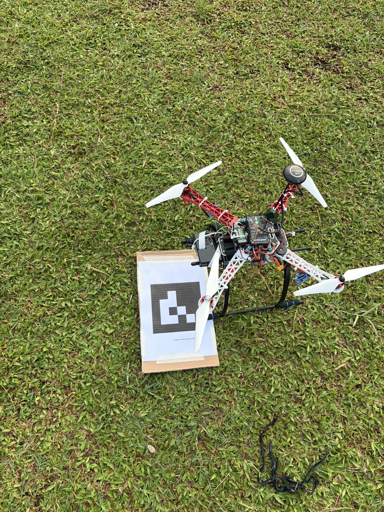
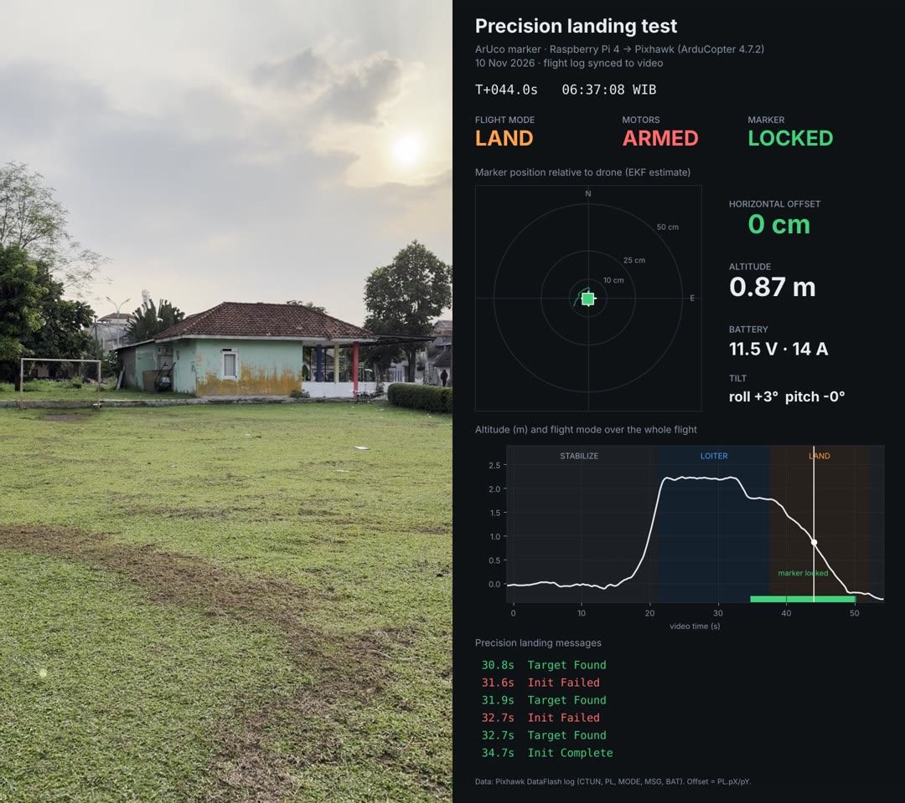

# ArUco precision-landing quadcopter

A DIY quadcopter that lands itself on a printed ArUco marker. A Raspberry Pi 4 camera finds the marker and sends its position to a Pixhawk flight controller running ArduCopter, which steers the drone down onto it.

This is a small-scale prototype of a bigger idea: **autonomous drones carrying HPV DNA samples (for cervical cancer screening) from remote Puskesmas (community health centres) in Indonesia to a lab.** Landing reliably on a known pad, without a pilot lining it up, is one of the first building blocks.

**Demo video (flight log synced to the video):** https://youtu.be/laPuemzHMS4

 

*Left: the drone on the grass next to the A3 landing marker. Right: a frame from the demo video with the synced flight log.*

## Result (field test, 10 Nov 2026)

| | |
|---|---|
| Marker lock | Confirmed while hovering in Loiter at about 2.2 m, before switching to Land |
| Tracking during descent | EKF estimate within about 5 cm of the marker |
| Touchdown | About **15–20 cm** from the marker centre (measured on site); the drone's own estimate was about 8 cm |
| Attempts | 3 in total. 1 successful precision landing. In the other two, Land was selected before the lock was confirmed (`PrecLand: Init Failed`), so the drone landed on GPS alone |

**Lesson from the failed attempts:** hold the drone still over the marker in Loiter for about 5 seconds, until `PrecLand: Init Complete` appears, and only then switch to Land.

## How it works

```
Pi camera (OV5647, pointing down)
      │  640×480 frames
      ▼
Raspberry Pi 4 ── software/precland.py
      │  OpenCV ArUco detection → marker pose (calibrated camera)
      │  MAVLink LANDING_TARGET (body frame), ~20 Hz, over UART 921600
      ▼
Pixhawk 2.4.8 ── ArduCopter 4.7.2
      │  PLND: Kalman filter fuses marker position with IMU/GPS
      ▼
Land mode steers horizontally onto the marker while descending
```

The Pi script also:
- starts automatically at boot (systemd), so no laptop or Wi-Fi is needed in the field;
- turns Wi-Fi off while the drone is armed, and back on 10 s after disarming;
- shuts the Pi down safely when a transmitter switch is held for 3 s while disarmed.

## Repository layout

| Folder | Contents |
|---|---|
| [`software/`](software) | `precland.py` (runs on the Pi), `calibrate.py` (camera calibration), `make_markers.py`, `install_service.sh` (start at boot) |
| [`markers/`](markers) | Landing marker (ArUco 4x4_50, id 0) for A4 and A3, and the calibration checkerboard |
| [`hardware/`](hardware) | Parts list, wiring, Pixhawk parameters, and lessons learned during the build |
| [`tools/`](tools) | Scripts that turn a DataFlash log into the telemetry panel used in the demo video |

## Quick start

1. Build and wire the drone: [`hardware/README.md`](hardware/README.md).
2. Set the Pixhawk parameters listed there.
3. On the Pi: follow [`software/SETUP.md`](software/SETUP.md) (serial port, packages, camera calibration, bench test).
4. Print `markers/landing_marker_A3.pdf` at 100% and measure the black square.
5. `bash software/install_service.sh --marker-size 0.26 --shutdown-channel 6`
6. Fly: take off, Loiter about 2–3 m above the marker, wait for `PrecLand: Init Complete`, then switch to Land.

## Safety

- Test with **props off** first (`precland.py --bench`).
- Keep a hand on the mode switch. If the drone moves the wrong way, switch to Loiter or Stabilize straight away.
- If the marker is lost, ArduPilot keeps landing using GPS (`PLND_STRICT = 0`).
- Connect and disconnect power wires only with the battery unplugged (see lessons learned).

## Credits

Hardware build, wiring, tuning and flight testing by Hanin Rahmania. The companion software was written with the help of an AI assistant (Claude) and then tested, debugged and tuned on the real drone.

## Licence

MIT. See [`LICENSE`](LICENSE).
